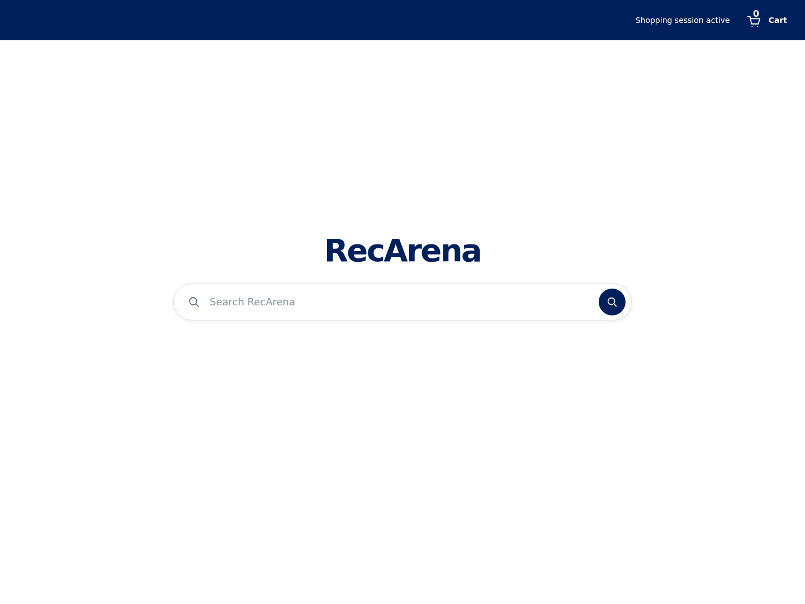
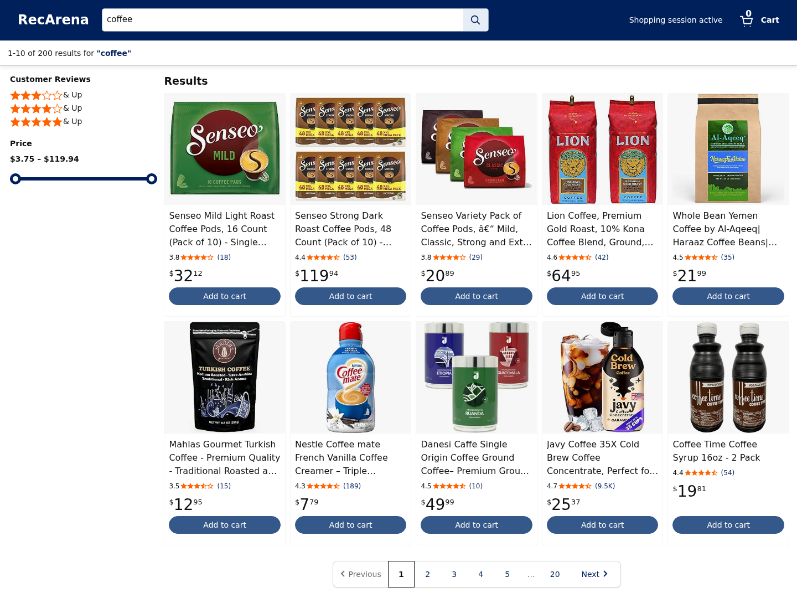
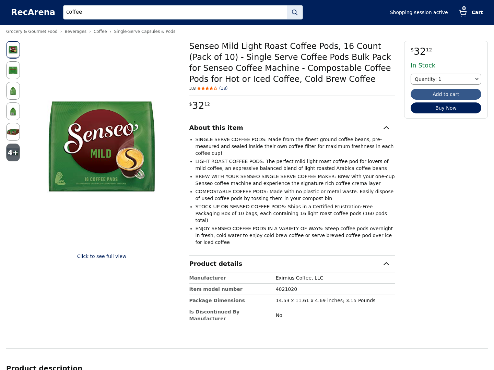
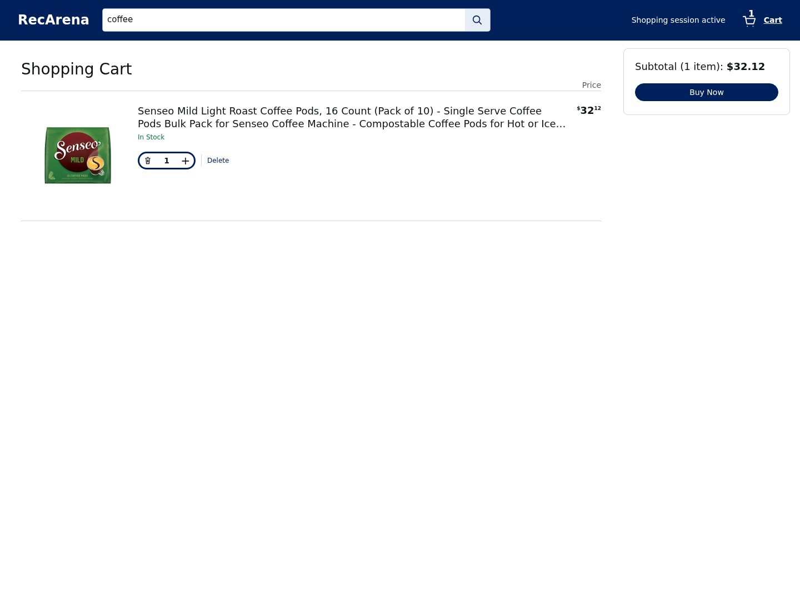

# RecArena

RecArena provides a shopping website, researcher console, session APIs and shopping records for AI-agent experiments. Researchers connect a recommendation service and give each agent an issued shopping URL. The platform keeps each session's results, cart, purchases and events together; agents and recommendation algorithms are supplied separately.

## Screenshots

Shopping interface screenshots. Click an image to view it at full size.

<table width="100%">
  <tr>
    <th width="50%">1. Home</th>
    <th width="50%">2. Search results</th>
  </tr>
  <tr>
    <td width="50%" valign="top"><a href="docs/images/home.png"></a></td>
    <td width="50%" valign="top"><a href="docs/images/search-results.png"></a></td>
  </tr>
  <tr>
    <th width="50%">3. Product detail</th>
    <th width="50%">4. Shopping cart</th>
  </tr>
  <tr>
    <td width="50%" valign="top"><a href="docs/images/product-detail.png"></a></td>
    <td width="50%" valign="top"><a href="docs/images/cart.png"></a></td>
  </tr>
</table>

## Requirements

- Linux/amd64 with Docker Engine and Compose v2.
- Bash, Python 3.10+ and curl on the Docker host.
- A prepared catalog with reviews and user history, and a recommendation HTTP service.

Starting from raw data? Follow the [example workflow](examples/README.md#workflow) to prepare Amazon data and a recommendation service. These examples have their own optional dependencies.

## Start the platform

Run commands from the repository root on the Docker host:

```bash
./recarena init
```

This creates private settings and credentials in the Git-ignored `configs/local/docker/`. Repeating it preserves existing values. Edit `settings.json`:

| Setting | Value |
|---|---|
| `RECARENA_RANKER_URL` | Recommendation service address reachable from the API container |
| `RECARENA_SHOP_PORT`, `RECARENA_ADMIN_PORT` | Unused host ports; defaults 5173 and 5174 |
| `RECARENA_SHOP_URL`, `RECARENA_ADMIN_URL` | Browser-facing addresses matching those ports |

Configure the recommendation service to accept `internal_token.secret`, and start it before the platform. It must advertise at least one policy through the [recommendation API](docs/RECOMMENDATION_API.md). The [example server's Compose instructions](examples/recommendation/ranker/README.md#serve-with-compose) provide an address on the platform network. A container's `127.0.0.1` refers to that container.

```bash
./recarena up
```

This builds the application images, starts PostgreSQL, applies migrations, and starts both frontends and the API. The host needs no application virtual environment, Node.js installation or separate PostgreSQL installation.

- Shopping: **http://127.0.0.1:5173**
- Administrator: **http://127.0.0.1:5174** — sign in with `configs/local/docker/admin_token.secret`.

Ports are published on host loopback. For remote access, configure a reverse proxy or tunnel and set the browser-facing URLs accordingly.

## Prepare a shop

Put a [catalog bundle](contracts/schemas/CatalogBundle.schema.json) or [catalog package](contracts/schemas/CatalogPackage.schema.json) under `artifacts/` and import its JSON entry file:

```bash
./recarena --docker data import --bundle artifacts/my-catalog/manifest.json
```

The import returns catalog, review and history snapshot IDs. The [Amazon adapter](examples/data/README.md#prepare-platform-data) produces a package in this format. Product `image_urls` are loaded directly by browsers; [self-hosted images](examples/data/README.md#optional-self-hosted-images) are optional.

Follow [environment registration](docs/RECOMMENDATION_API.md#publish-a-platform-environment) to copy the provided configuration, bind the imported snapshots to a discovered policy, and publish it. In the administrator, save a policy name pointing to that environment. The environment also sets page layout, filters and cart availability. Each issued session retains its published settings.

## Issue a shopping URL

Use an imported research user ID and the saved policy name. Adjust the administrator address if you changed its port:

```bash
export RECARENA_ADMIN_URL=http://127.0.0.1:5174
export RECARENA_SESSION_API_KEY="$(cat configs/local/docker/session_api_key.secret)"

python3 examples/create_session.py \
  --api-base-url "$RECARENA_ADMIN_URL" \
  --user-id YOUR_USER_ID --policy YOUR_POLICY_NAME
```

Give the printed URL to the agent. Issue a new session for each trial; shopping links retain its opaque session ID. Opening the shopping root without a session shows a session-required page. Keep the API key in the experiment script's environment.

Use `python3 examples/create_session.py --help` for session termination, trial labels and retry options.

## View records

Open **Rollouts & results** in the administrator to inspect sessions, purchases and events, or download their records. Exports are saved under `outputs/exports/<export_id>/`.

The [record guide](docs/RECORDS.md) explains the files, event meanings, identifier links and integrity check. Research metrics are calculated outside the platform; the [judging example](examples/judging/README.md) provides PS/QC/Hit evaluation for prepared tasks and selected products.

## Stop

```bash
./recarena down
```

The database volume is retained for the next startup. Optional recommendation containers have their own [stop command](examples/recommendation/ranker/README.md#serve-with-compose).

## Optional examples

The [examples guide](examples/README.md) connects data preparation, recommendation training and serving, scenario generation and product judging. Use the parts needed for your study. Agent-specific memory preparation and execution are separate work.

## Repository layout

```text
RecArena/
├── backend/       # Platform APIs, sessions, purchases and records
├── frontend/      # Shopping website and researcher console
├── contracts/     # API and data schemas
├── examples/      # Optional data, recommendation, scenario and judging workflows
├── configs/       # Configuration examples
├── docker/        # Container images and service configuration
├── scripts/       # Deployment and platform command helpers
├── docs/          # Recommendation API, records and screenshots
└── recarena       # Platform command entry point
```
